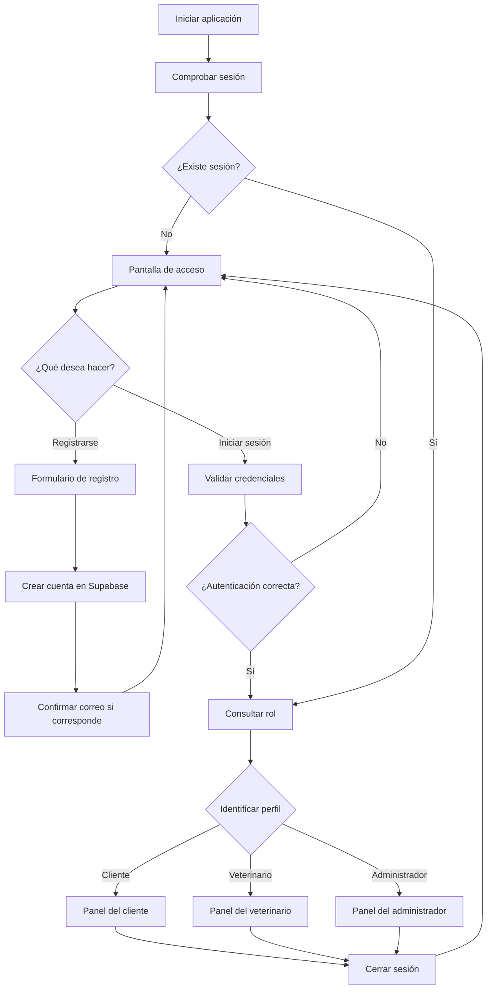
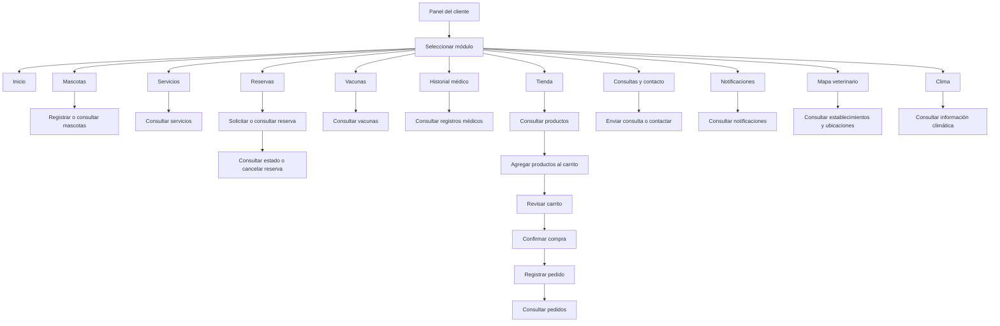
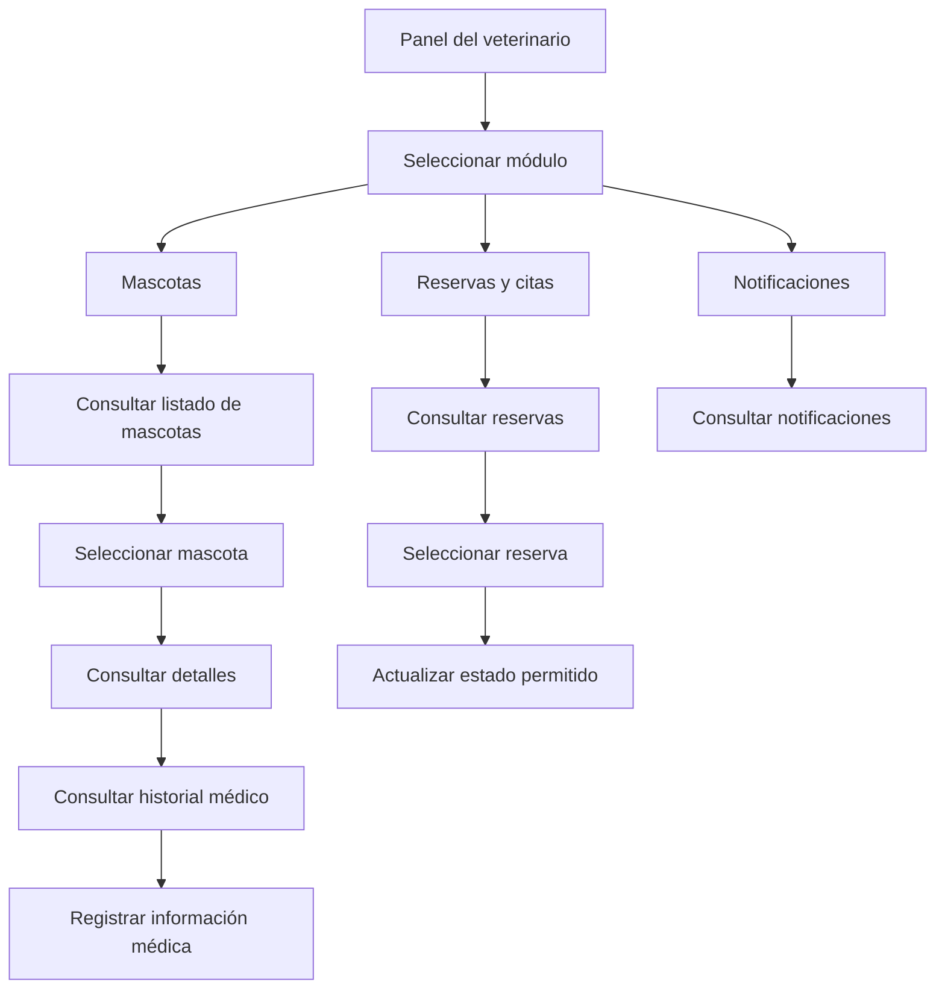
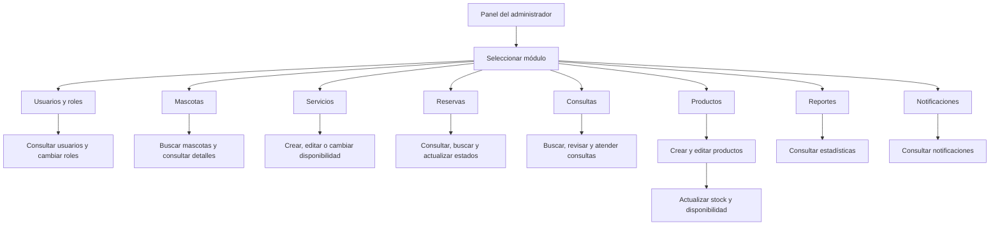

# 04. Casos de uso
## Proyecto: PetCare Santa Cruz

### 1. Introducción

Los casos de uso describen las interacciones entre los usuarios y el sistema PetCare Santa Cruz. Permiten identificar las funcionalidades disponibles para cada perfil y comprender cómo se utilizan los diferentes módulos de la aplicación.

El sistema contempla tres actores principales: cliente, veterinario y administrador. Además, utiliza Supabase como servicio backend para la autenticación, almacenamiento y gestión de información.

### 2. Actores del sistema

| Actor | Descripción |
|---|---|
| Cliente | Persona que registra sus mascotas y utiliza los servicios de la aplicación. |
| Veterinario | Profesional encargado de consultar información médica, atender mascotas y gestionar reservas según sus permisos. |
| Administrador | Usuario responsable de la gestión general del sistema y de las operaciones administrativas autorizadas. |
| Supabase | Servicio backend que proporciona autenticación, almacenamiento, acceso a los datos y actualizaciones en tiempo real. |

### 3. Casos de uso generales

| Código | Caso de uso | Actor |
|---|---|---|
| CU-001 | Registrarse | Cliente |
| CU-002 | Iniciar sesión | Cliente, veterinario y administrador |
| CU-003 | Recuperar contraseña | Usuario registrado |
| CU-004 | Cerrar sesión | Usuario autenticado |
| CU-005 | Registrar mascota | Cliente |
| CU-006 | Consultar mascotas | Cliente, veterinario y administrador |
| CU-007 | Consultar servicios | Cliente |
| CU-008 | Solicitar reserva | Cliente |
| CU-009 | Consultar reservas | Cliente, veterinario y administrador |
| CU-010 | Actualizar estado de reserva | Veterinario y administrador |
| CU-011 | Consultar vacunas | Cliente |
| CU-012 | Consultar historial médico | Cliente y veterinario |
| CU-013 | Registrar información médica | Veterinario |
| CU-014 | Consultar productos | Cliente |
| CU-015 | Consultar notificaciones | Usuario autenticado |
| CU-016 | Marcar notificación como leída | Usuario autenticado |
| CU-017 | Gestionar usuarios y roles | Administrador |
| CU-018 | Gestionar servicios | Administrador |
| CU-019 | Consultar y buscar mascotas | Administrador |
| CU-020 | Consultar reportes | Administrador |
| CU-021 | Consultar y gestionar consultas | Administrador |
| CU-022 | Gestionar productos | Administrador |
| CU-023 | Actualizar stock de productos | Administrador |
| CU-024 | Activar o desactivar productos | Administrador |
| CU-025 | Consultar detalles de una reserva | Administrador |
| CU-026 | Recibir actualizaciones en tiempo real | Cliente, veterinario y administrador |
| CU-027 | Confirmar correo electrónico | Cliente |
| CU-028 | Cancelar reserva propia | Cliente |
| CU-029 | Gestionar carrito de compras | Cliente |
| CU-030 | Confirmar compra y registrar pedido | Cliente |
| CU-031 | Consultar pedidos realizados | Cliente y administrador |
| CU-032 | Consultar establecimientos veterinarios en el mapa | Cliente |
| CU-033 | Consultar ubicación y contactar establecimientos | Cliente |
| CU-034 | Consultar información climática | Cliente |

### 4. Descripción de casos de uso principales

#### CU-001. Registrarse

- **Actor:** Cliente.
- **Objetivo:** Crear una cuenta en PetCare.
- **Precondición:** El usuario no debe tener una cuenta registrada con el mismo correo.
- **Flujo principal:**
  1. El usuario abre la pantalla de registro.
  2. Ingresa sus datos personales.
  3. Introduce su correo electrónico y contraseña.
  4. El sistema procesa el registro mediante Supabase.
  5. Se crea el perfil correspondiente con el rol inicial de cliente.
  6. Si la confirmación de correo está habilitada, el sistema solicita verificar la dirección registrada.
- **Resultado:** El usuario dispone de una cuenta en el sistema.

#### CU-002. Iniciar sesión

- **Actor:** Cliente, veterinario o administrador.
- **Objetivo:** Acceder a las funcionalidades correspondientes al rol.
- **Precondición:** El usuario debe tener una cuenta registrada y cumplir los requisitos de autenticación.
- **Flujo principal:**
  1. El usuario introduce su correo y contraseña.
  2. El sistema valida las credenciales.
  3. Supabase autentica al usuario.
  4. La aplicación identifica su rol.
  5. Se muestra el panel correspondiente al perfil.
- **Resultado:** El usuario accede a su espacio de trabajo.

#### CU-003. Recuperar contraseña

- **Actor:** Usuario registrado.
- **Objetivo:** Restablecer la contraseña de acceso.
- **Precondición:** El usuario debe tener una cuenta registrada.
- **Flujo principal:**
  1. El usuario selecciona la opción de recuperar contraseña.
  2. Introduce su correo electrónico.
  3. El sistema solicita a Supabase el envío del correo de recuperación.
  4. El usuario accede al enlace recibido.
  5. Introduce y confirma una nueva contraseña.
- **Resultado:** La contraseña queda actualizada.

#### CU-005. Registrar mascota

- **Actor:** Cliente.
- **Objetivo:** Registrar una mascota en el sistema.
- **Precondición:** El cliente debe haber iniciado sesión.
- **Flujo principal:**
  1. El cliente ingresa al módulo de mascotas.
  2. Selecciona la opción de registro.
  3. Introduce los datos de la mascota.
  4. El sistema valida la información.
  5. Se guarda el registro en la base de datos.
  6. La mascota queda asociada al usuario autenticado.
- **Resultado:** La mascota queda registrada y disponible para su consulta.

#### CU-008. Solicitar reserva

- **Actor:** Cliente.
- **Objetivo:** Solicitar una cita veterinaria.
- **Precondición:** El cliente debe estar autenticado.
- **Flujo principal:**
  1. El cliente ingresa al módulo de reservas.
  2. Consulta los servicios disponibles.
  3. Selecciona la mascota y los datos de la cita.
  4. Introduce la información solicitada.
  5. Envía la solicitud.
  6. El sistema registra la reserva.
  7. Se generan las notificaciones correspondientes para los destinatarios configurados.
- **Resultado:** La solicitud queda registrada para su gestión.

#### CU-009. Consultar reservas

- **Actor:** Cliente, veterinario o administrador.
- **Objetivo:** Consultar las reservas registradas según los permisos del usuario.
- **Precondición:** El usuario debe estar autenticado.
- **Flujo principal:**
  1. El usuario ingresa al módulo de reservas correspondiente a su perfil.
  2. El sistema consulta los registros permitidos.
  3. Se muestran los datos y estados de las reservas.
  4. El usuario puede seleccionar una reserva para consultar sus detalles, cuando la pantalla lo permite.
- **Resultado:** Se visualiza la información de las reservas autorizadas.

#### CU-010. Actualizar estado de reserva

- **Actor:** Veterinario o administrador.
- **Objetivo:** Actualizar el estado de una reserva.
- **Precondición:** Debe existir una reserva registrada y el usuario debe contar con los permisos correspondientes.
- **Flujo principal:**
  1. El usuario consulta las reservas.
  2. Selecciona una reserva.
  3. Actualiza su estado según las opciones disponibles y sus permisos.
  4. El sistema procesa el cambio.
  5. Se actualiza la información de la reserva.
  6. Se genera la notificación correspondiente cuando el evento está configurado.
- **Resultado:** El estado de la reserva queda actualizado.

#### CU-012. Consultar historial médico

- **Actor:** Cliente o veterinario.
- **Objetivo:** Consultar los registros médicos de una mascota.
- **Precondición:** El usuario debe estar autenticado y contar con permisos para consultar la información.
- **Flujo principal:**
  1. El usuario ingresa al módulo correspondiente.
  2. Selecciona una mascota.
  3. El sistema consulta los registros médicos permitidos.
  4. Se muestran los datos disponibles del historial.
- **Resultado:** Se visualiza la información médica autorizada.

#### CU-013. Registrar información médica

- **Actor:** Veterinario.
- **Objetivo:** Registrar información médica de una mascota.
- **Precondición:** El veterinario debe estar autenticado y tener acceso a la mascota.
- **Flujo principal:**
  1. El veterinario consulta las mascotas.
  2. Selecciona una mascota.
  3. Accede al historial médico.
  4. Introduce los datos médicos correspondientes.
  5. Guarda el registro.
  6. El sistema almacena la información y genera la notificación correspondiente.
- **Resultado:** Se incorpora un nuevo registro al historial médico.

#### CU-017. Gestionar usuarios y roles

- **Actor:** Administrador.
- **Objetivo:** Administrar los perfiles y roles de los usuarios.
- **Precondición:** El usuario debe tener rol de administrador.
- **Flujo principal:**
  1. El administrador ingresa al panel administrativo.
  2. Consulta los usuarios registrados.
  3. Selecciona un usuario.
  4. Realiza el cambio de rol permitido.
  5. El sistema procesa la operación mediante una función protegida.
- **Resultado:** El rol del usuario queda actualizado según los permisos establecidos.

#### CU-018. Gestionar servicios

- **Actor:** Administrador.
- **Objetivo:** Administrar los servicios veterinarios.
- **Precondición:** El administrador debe estar autenticado.
- **Flujo principal:**
  1. El administrador ingresa al módulo de servicios.
  2. Consulta los servicios registrados.
  3. Puede crear un nuevo servicio o seleccionar uno existente.
  4. Introduce o modifica los datos correspondientes.
  5. Puede cambiar la disponibilidad del servicio.
  6. El sistema guarda la operación mediante las funciones administrativas.
- **Resultado:** Los servicios quedan actualizados y su disponibilidad se refleja en la aplicación.

#### CU-019. Consultar y buscar mascotas

- **Actor:** Administrador.
- **Objetivo:** Consultar las mascotas registradas y sus datos principales.
- **Precondición:** El administrador debe estar autenticado.
- **Flujo principal:**
  1. El administrador ingresa al módulo de gestión de mascotas.
  2. El sistema consulta los registros mediante la función administrativa.
  3. Se muestra el listado de mascotas.
  4. El administrador puede buscar por nombre, especie, raza o propietario.
  5. Selecciona una mascota para consultar sus detalles.
- **Resultado:** El administrador obtiene la información de las mascotas registradas.

#### CU-020. Consultar reportes

- **Actor:** Administrador.
- **Objetivo:** Consultar estadísticas generales del sistema.
- **Precondición:** El administrador debe estar autenticado.
- **Flujo principal:**
  1. El administrador ingresa al módulo de reportes.
  2. El sistema solicita las estadísticas administrativas.
  3. Se procesan los datos disponibles.
  4. Se muestran los indicadores y reportes correspondientes.
- **Resultado:** El administrador visualiza información estadística del sistema.

#### CU-021. Consultar y gestionar consultas

- **Actor:** Administrador.
- **Objetivo:** Revisar las consultas enviadas por los clientes y actualizar su estado.
- **Precondición:** El administrador debe estar autenticado y deben existir consultas registradas.
- **Flujo principal:**
  1. El administrador ingresa al módulo de consultas.
  2. El sistema muestra las consultas registradas.
  3. El administrador puede buscar consultas.
  4. Selecciona una consulta para revisar sus detalles.
  5. Puede cambiar su estado entre pendiente y atendida.
  6. El sistema procesa el cambio mediante la función administrativa correspondiente.
  7. El administrador puede utilizar la opción de contacto por WhatsApp cuando corresponda.
- **Resultado:** La consulta queda revisada y su estado actualizado.

#### CU-022. Gestionar productos

- **Actor:** Administrador.
- **Objetivo:** Administrar la información de los productos de la tienda.
- **Precondición:** El administrador debe estar autenticado.
- **Flujo principal:**
  1. El administrador ingresa al módulo de productos.
  2. Consulta los productos registrados.
  3. Puede crear un nuevo producto.
  4. Puede seleccionar un producto existente para editar sus datos.
  5. El sistema procesa y guarda la operación mediante las funciones administrativas.
- **Resultado:** La información de los productos queda registrada o actualizada.

#### CU-023. Actualizar stock de productos

- **Actor:** Administrador.
- **Objetivo:** Mantener actualizado el stock de los productos.
- **Precondición:** El producto debe estar registrado y el administrador debe estar autenticado.
- **Flujo principal:**
  1. El administrador ingresa al módulo de productos.
  2. Selecciona un producto.
  3. Introduce la cantidad de stock correspondiente.
  4. Confirma la operación.
  5. El sistema actualiza el stock mediante una función protegida.
- **Resultado:** El stock del producto queda actualizado.

#### CU-024. Activar o desactivar productos

- **Actor:** Administrador.
- **Objetivo:** Controlar la disponibilidad de los productos en la tienda.
- **Precondición:** El producto debe estar registrado.
- **Flujo principal:**
  1. El administrador consulta los productos.
  2. Selecciona un producto.
  3. Cambia su estado de disponibilidad.
  4. El sistema guarda el cambio.
  5. La tienda refleja el estado actualizado del producto.
- **Resultado:** Los productos activos se muestran en la tienda para los clientes; los desactivados dejan de mostrarse.

#### CU-026. Recibir actualizaciones en tiempo real

- **Actor:** Cliente, veterinario o administrador.
- **Objetivo:** Mantener actualizada la información de los módulos que utilizan Supabase Realtime.
- **Precondición:** El usuario debe estar autenticado y encontrarse en un módulo con suscripción configurada.
- **Flujo principal:**
  1. El usuario ingresa a un módulo compatible con actualizaciones en tiempo real.
  2. La aplicación establece la suscripción correspondiente.
  3. Se produce un cambio en los datos de la tabla suscrita.
  4. Supabase Realtime comunica el evento.
  5. La aplicación actualiza la información mostrada.
- **Resultado:** La pantalla refleja los cambios recibidos sin requerir una actualización manual, según la suscripción configurada.

#### CU-028. Cancelar reserva propia

- **Actor:** Cliente.
- **Objetivo:** Cancelar una reserva realizada por el propio cliente.
- **Precondición:** El cliente debe estar autenticado y tener una reserva registrada.
- **Flujo principal:**
  1. El cliente ingresa al módulo de reservas.
  2. Consulta sus reservas.
  3. Selecciona la reserva que desea cancelar.
  4. Selecciona la opción de cancelación.
  5. El sistema actualiza el estado de la reserva según los permisos establecidos.
- **Resultado:** La reserva queda con el estado de cancelación correspondiente.

#### CU-029. Gestionar carrito de compras

- **Actor:** Cliente.
- **Objetivo:** Organizar los productos que desea comprar.
- **Precondición:** El cliente debe acceder a la tienda y seleccionar productos disponibles.
- **Flujo principal:**
  1. El cliente ingresa a la tienda.
  2. Consulta los productos disponibles.
  3. Selecciona un producto.
  4. Lo agrega al carrito.
  5. Consulta los productos agregados.
  6. Puede modificar las cantidades o retirar productos según las opciones disponibles.
- **Resultado:** El carrito muestra los productos seleccionados y sus cantidades.

#### CU-030. Confirmar compra y registrar pedido

- **Actor:** Cliente.
- **Objetivo:** Registrar un pedido a partir de los productos seleccionados.
- **Precondición:** El cliente debe tener productos en el carrito.
- **Flujo principal:**
  1. El cliente ingresa al carrito.
  2. Revisa los productos y las cantidades.
  3. Consulta el total de la compra.
  4. Confirma la operación.
  5. El sistema registra el pedido asociado al usuario autenticado.
  6. El sistema muestra el resultado de la operación.
- **Resultado:** El pedido queda registrado en el sistema.

#### CU-031. Consultar pedidos realizados

- **Actor:** Cliente y administrador.
- **Objetivo:** Consultar los pedidos registrados.
- **Precondición:** El usuario debe estar autenticado y contar con los permisos correspondientes.
- **Flujo principal:**
  1. El usuario ingresa al módulo de pedidos correspondiente a su perfil.
  2. El sistema consulta los pedidos permitidos.
  3. Se muestran los datos y estados disponibles.
  4. El usuario selecciona un pedido para consultar sus detalles, cuando la pantalla lo permite.
- **Resultado:** Se visualiza la información de los pedidos autorizados.

#### CU-032. Consultar establecimientos veterinarios en el mapa

- **Actor:** Cliente.
- **Objetivo:** Visualizar la ubicación de establecimientos veterinarios.
- **Precondición:** El dispositivo debe disponer de conexión a Internet.
- **Flujo principal:**
  1. El cliente ingresa al módulo del mapa.
  2. La aplicación consulta los establecimientos registrados.
  3. Se obtiene la información de ubicación disponible.
  4. El sistema muestra un mapa con los establecimientos encontrados.
  5. El cliente selecciona un establecimiento para consultar sus detalles.
- **Resultado:** El cliente puede visualizar la ubicación y los datos disponibles de los establecimientos.

#### CU-033. Consultar ubicación y contactar establecimientos

- **Actor:** Cliente.
- **Objetivo:** Consultar la ubicación de un establecimiento y utilizar sus opciones de contacto.
- **Precondición:** El establecimiento debe contar con información de ubicación o contacto.
- **Flujo principal:**
  1. El cliente selecciona un establecimiento.
  2. Consulta los datos disponibles.
  3. Puede seleccionar la opción de WhatsApp si existe un número registrado.
  4. Puede realizar una llamada si existe un teléfono disponible.
  5. Puede abrir la ubicación o ruta mediante una aplicación externa de mapas.
- **Resultado:** El cliente puede utilizar las opciones de contacto y ubicación disponibles.

#### CU-034. Consultar información climática

- **Actor:** Cliente.
- **Objetivo:** Consultar las condiciones climáticas disponibles.
- **Precondición:** El dispositivo debe disponer de conexión a Internet para consultar el servicio externo.
- **Flujo principal:**
  1. El cliente ingresa al módulo de clima.
  2. La aplicación solicita información al servicio Open-Meteo.
  3. El sistema procesa la respuesta recibida.
  4. Se muestran los datos disponibles, como temperatura actual, sensación térmica, humedad, viento y precipitación.
  5. Si ocurre un error de conexión, se muestra un mensaje informativo.
- **Resultado:** El cliente visualiza la información climática disponible o un mensaje indicando que no fue posible obtenerla.

### 5. Flujos generales de navegación

#### 5.1. Flujo de autenticación y acceso

#### 5.2. Flujo del cliente

#### 5.3. Flujo del veterinario

#### 5.4. Flujo del administrador

### 6. Reglas generales de los casos de uso

- Cada usuario debe autenticarse para acceder a las funciones protegidas.
- Las funcionalidades disponibles dependen del rol asignado.
- Las operaciones deben respetar las políticas de seguridad de Supabase.
- Los datos de las mascotas deben mantenerse asociados a sus propietarios.
- Las modificaciones deben realizarse según los permisos establecidos.
- Los clientes pueden consultar sus propios registros y cancelar sus reservas mediante las opciones permitidas.
- Los veterinarios pueden consultar información de las mascotas y registrar nuevos datos médicos según sus permisos.
- Los administradores pueden realizar las operaciones administrativas habilitadas mediante las funciones protegidas del backend.
- Las actualizaciones en tiempo real dependen de las suscripciones configuradas en cada módulo.

### 7. Consideraciones finales

Los casos de uso permiten comprender el funcionamiento de PetCare Santa Cruz desde la perspectiva de sus usuarios. Los flujos de navegación representan el recorrido general de cada perfil dentro de la aplicación.

Estos diagramas constituyen una referencia para las pruebas funcionales, la documentación, el mantenimiento y la evolución del sistema.