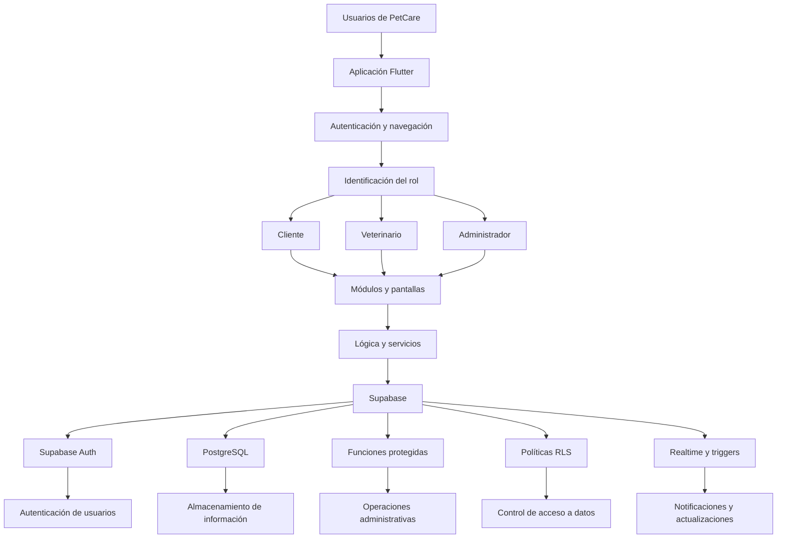
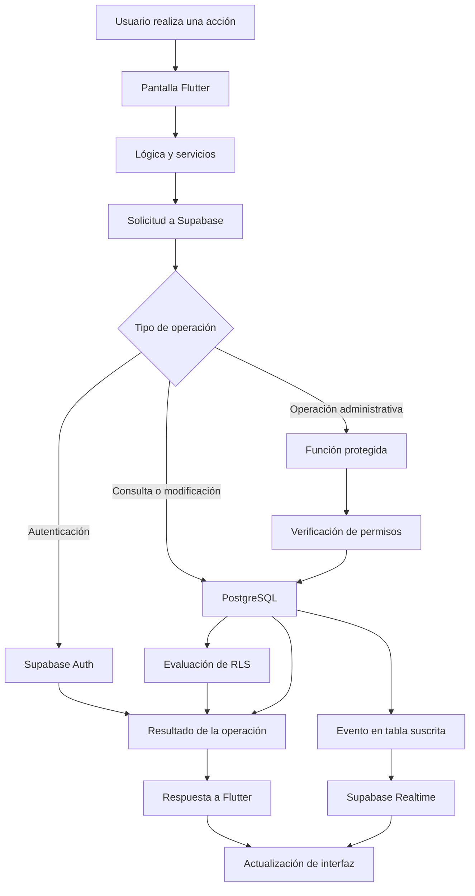

# 05. Arquitectura del sistema
## Proyecto: PetCare Santa Cruz

### 1. Introducción

PetCare Santa Cruz utiliza una arquitectura basada en Flutter para la interfaz de usuario y Supabase como plataforma backend para la autenticación, almacenamiento y gestión de información.

El proyecto está organizado mediante una estructura modular basada en funcionalidades, lo que permite separar responsabilidades y facilitar el mantenimiento del código.

La aplicación contempla tres perfiles principales: cliente, veterinario y administrador. Cada perfil dispone de módulos y operaciones de acuerdo con sus responsabilidades y permisos.

### 2. Arquitectura general

La arquitectura se compone de tres elementos principales:

1. **Capa de presentación:** desarrollada con Flutter y Dart. Contiene las pantallas, formularios, componentes visuales y navegación.
2. **Capa de lógica y servicios:** contiene modelos, servicios, validaciones y operaciones que permiten gestionar la información de la aplicación y comunicarse con el backend.
3. **Capa de backend y datos:** utiliza Supabase y PostgreSQL para autenticación, almacenamiento, consultas, control de acceso y actualizaciones en tiempo real.

Estas capas trabajan de manera integrada para permitir que los usuarios realicen operaciones desde la aplicación y reciban información de acuerdo con sus permisos.

### 3. Diagrama general de arquitectura



### 4. Organización del código fuente

La carpeta `lib` utiliza una organización modular por funcionalidades, separando los componentes generales y las pantallas correspondientes a cada perfil.

```text
lib/
├── main.dart
├── config/
│   └── config.dart
├── core/
│   ├── constants/
│   ├── theme/
│   └── widgets/
├── database/
│   └── database_helper.dart
├── features/
│   ├── administrador/
│   │   └── screens/
│   ├── auth/
│   │   └── screens/
│   ├── cliente/
│   │   └── screens/
│   ├── notificaciones/
│   │   └── screens/
│   └── veterinario/
│       └── screens/
├── models/
├── services/
├── utils/
└── widgets/
```

### 5. Descripción de los componentes

| Componente | Responsabilidad |
|---|---|
| main.dart | Inicialización de la aplicación y configuración de navegación. |
| config | Configuración de conexión con Supabase. |
| core | Elementos compartidos, constantes y tema visual. |
| database | Funcionalidades relacionadas con la gestión de datos. |
| features/auth | Pantallas de registro, inicio de sesión y recuperación de contraseña. |
| features/cliente | Funcionalidades disponibles para los clientes, como mascotas, servicios, reservas, vacunas, historial, tienda y consultas. |
| features/veterinario | Herramientas para consultar mascotas, revisar historiales médicos y gestionar reservas. |
| features/administrador | Herramientas para gestionar usuarios, mascotas, servicios, reservas, consultas y productos, además de consultar reportes. |
| features/notificaciones | Consulta y gestión de notificaciones. |
| models | Modelos de datos utilizados por la aplicación. |
| services | Servicios para operaciones y acceso a información. |
| utils | Validaciones y funciones auxiliares. |
| widgets | Componentes visuales reutilizables. |

### 6. Backend y servicios

Supabase proporciona los servicios backend utilizados por PetCare Santa Cruz.

Sus principales componentes son:

- **Supabase Auth:** gestiona el registro, inicio de sesión y recuperación de contraseñas. También permite gestionar la confirmación del correo electrónico cuando está habilitada.
- **PostgreSQL:** almacena los perfiles, mascotas, reservas, historiales médicos, servicios, productos, consultas y notificaciones.
- **Row Level Security (RLS):** establece políticas de acceso a los datos según el usuario y sus permisos.
- **Funciones protegidas:** permiten ejecutar operaciones administrativas, como consultar registros, gestionar roles, administrar servicios y productos y actualizar estados.
- **Triggers:** automatizan determinadas acciones relacionadas con los registros, incluyendo la generación de notificaciones ante eventos configurados.
- **Supabase Realtime:** permite recibir cambios en tiempo real en los módulos que tienen suscripciones configuradas.

### 7. Módulos principales del sistema

#### 7.1. Módulo de autenticación

Permite registrar usuarios, iniciar y cerrar sesión y solicitar recuperación de contraseña. Después de autenticar al usuario, la aplicación identifica su rol y dirige la navegación al espacio correspondiente.

#### 7.2. Módulo del cliente

Incluye las siguientes funcionalidades:

- Consulta del panel principal.
- Registro y consulta de mascotas.
- Consulta de servicios veterinarios.
- Solicitud y consulta de reservas.
- Consulta de vacunas.
- Consulta del historial médico.
- Consulta de productos disponibles en la tienda.
- Acceso a consultas e información de contacto.
- Consulta de notificaciones.

#### 7.3. Módulo del veterinario

Incluye las siguientes funcionalidades:

- Panel principal del veterinario.
- Consulta de mascotas registradas.
- Consulta de detalles de las mascotas.
- Consulta de historiales médicos.
- Registro de nueva información médica.
- Consulta de reservas y actualización de sus estados según los permisos establecidos.
- Consulta de notificaciones.

#### 7.4. Módulo del administrador

Incluye las siguientes funcionalidades:

- Panel administrativo con indicadores generales.
- Consulta y gestión de usuarios y roles.
- Consulta y búsqueda de mascotas.
- Creación, edición y control de disponibilidad de servicios.
- Consulta y gestión de reservas.
- Consulta, búsqueda y actualización del estado de las consultas.
- Creación y edición de productos.
- Actualización del stock de productos.
- Activación y desactivación de productos.
- Consulta de reportes y estadísticas.
- Consulta de notificaciones administrativas.

#### 7.5. Módulo de notificaciones

Permite consultar las notificaciones asociadas al usuario autenticado y actualizar su estado de lectura. Los eventos configurados en el backend generan notificaciones para los destinatarios correspondientes.

### 8. Seguridad y control de acceso

El sistema implementa control de acceso basado en roles:

- **Cliente:** accede a sus propios registros y a las funcionalidades disponibles para su perfil.
- **Veterinario:** accede a la información necesaria para la atención veterinaria y puede registrar información médica según los permisos establecidos.
- **Administrador:** accede a las operaciones administrativas autorizadas mediante funciones protegidas del backend.

Las políticas RLS complementan los controles de la aplicación y permiten restringir las operaciones directamente en la base de datos.

Las funciones administrativas verifican los permisos correspondientes antes de ejecutar operaciones sensibles. De esta manera, la seguridad no depende únicamente de las opciones que muestra la interfaz.

### 9. Actualizaciones en tiempo real

PetCare utiliza Supabase Realtime para reflejar cambios en los módulos que tienen suscripciones configuradas.

Entre las tablas utilizadas en estas actualizaciones se encuentran:

- `mascotas`
- `reservas`
- `historial_medico`
- `notificaciones`
- `productos`
- `consultas`
- `perfiles`

Cuando se produce un cambio en una tabla suscrita, la aplicación recibe el evento y actualiza la información de la pantalla correspondiente.

Este mecanismo permite que los cambios relevantes se reflejen sin depender exclusivamente de una actualización manual.

### 10. Flujo general de funcionamiento

1. El usuario abre PetCare Santa Cruz.
2. La aplicación inicializa Flutter y los servicios necesarios.
3. El sistema comprueba si existe una sesión autenticada.
4. Si no existe una sesión, se muestran las opciones de registro e inicio de sesión.
5. Supabase Auth valida las credenciales del usuario.
6. La aplicación identifica el rol asociado al perfil.
7. Se muestra el panel correspondiente al cliente, veterinario o administrador.
8. El usuario accede a los módulos disponibles para su perfil.
9. Las operaciones se procesan mediante la lógica de la aplicación y las solicitudes a Supabase.
10. PostgreSQL evalúa las políticas RLS y los permisos correspondientes.
11. La aplicación recibe los resultados y actualiza la interfaz.
12. Cuando existen suscripciones configuradas, Supabase Realtime comunica los cambios correspondientes.

### 11. Diagrama de comunicación entre la aplicación y el backend



### 12. Consideraciones finales

La arquitectura modular de PetCare Santa Cruz permite mantener separadas las funcionalidades de cada perfil y facilita el mantenimiento del código.

La utilización de Flutter y Supabase proporciona una base tecnológica para el desarrollo, autenticación, almacenamiento, control de acceso y actualización de información en tiempo real.

La separación entre la interfaz, la lógica de la aplicación y los servicios backend permite organizar las responsabilidades del sistema y facilita la incorporación de nuevas funcionalidades.